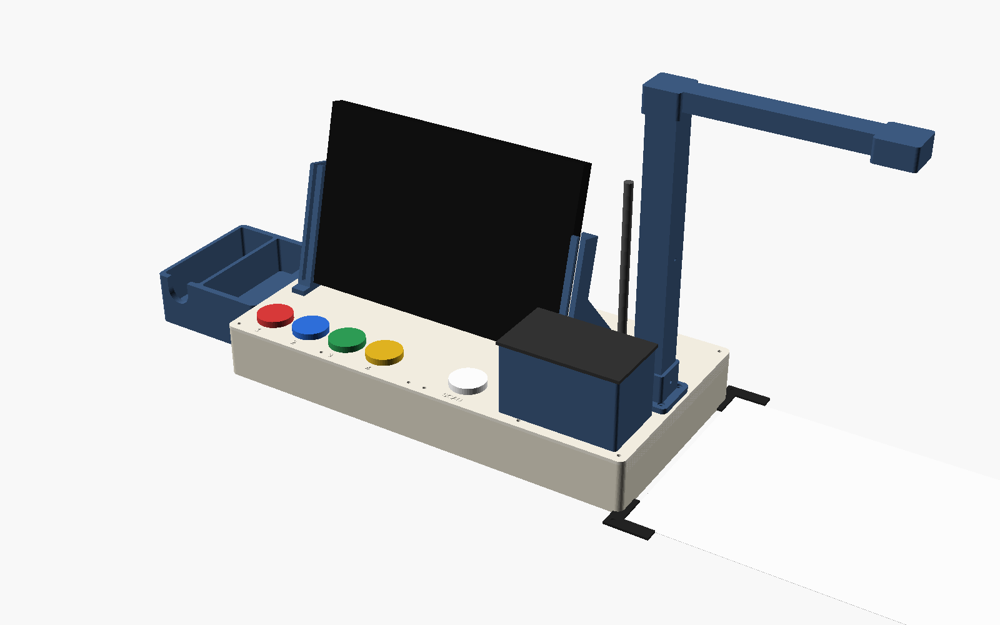
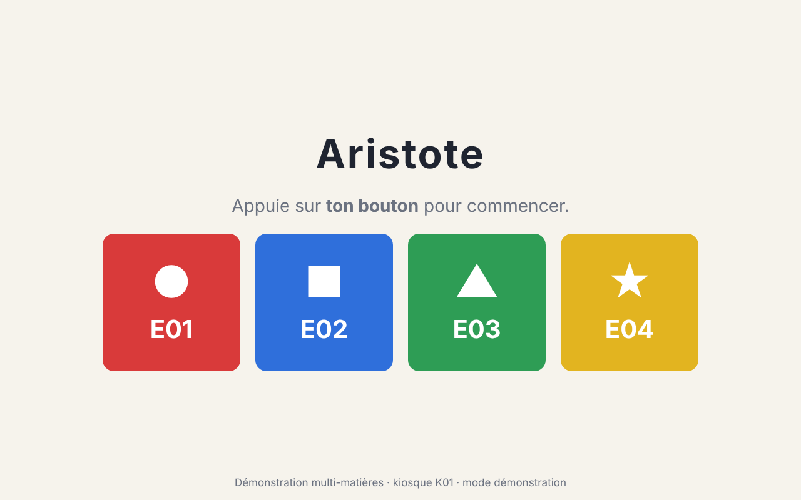
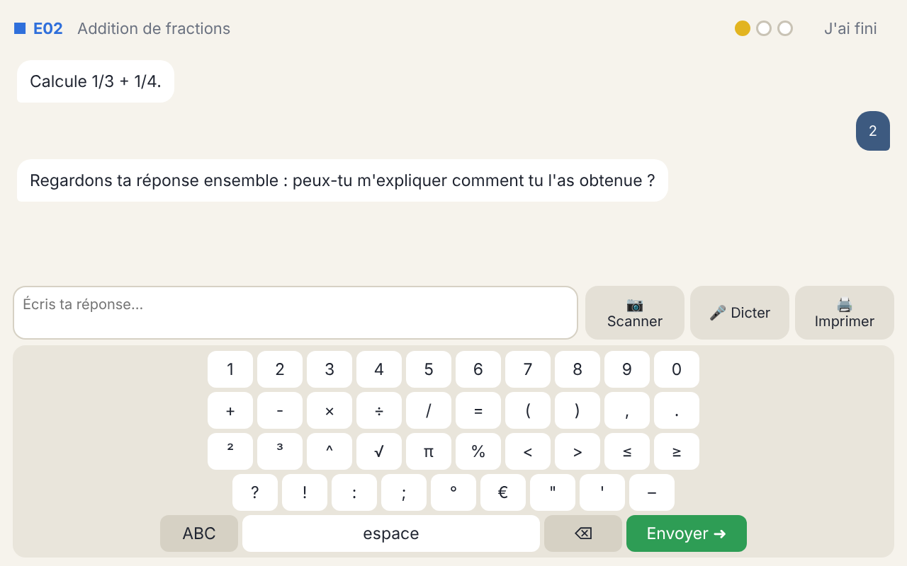
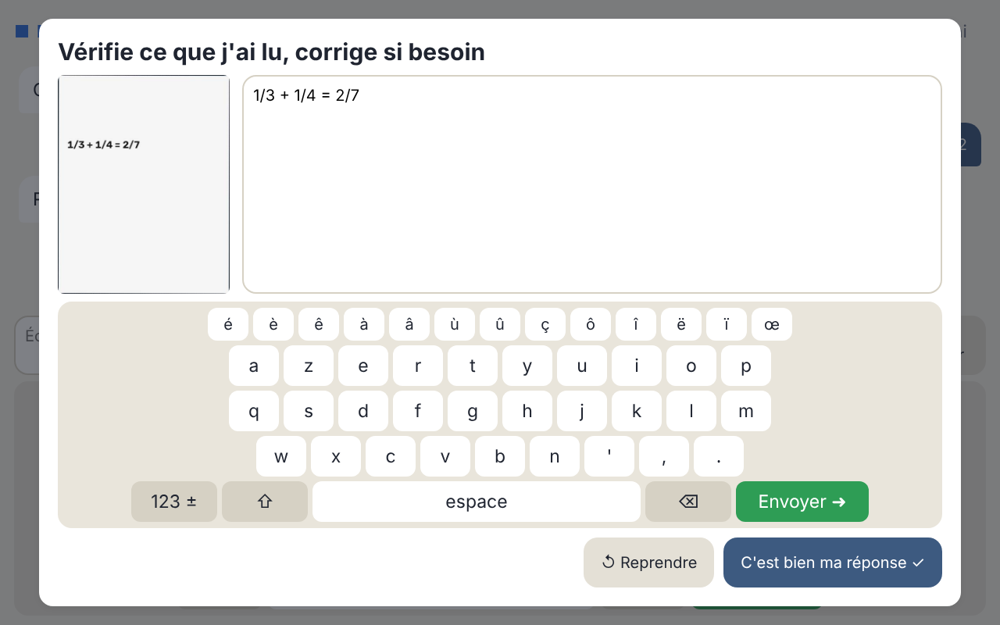

# Aristote 4 All — kiosque de tutorat socratique

*AI is here! why not supercharge teaching?*

Aristote est un **kiosque éducatif de bureau** partagé par 4 élèves. C'est un plateau compact imprimé en 3D sur
lequel s'enfichent un écran tactile, une caméra, un micro, une imprimante de tickets et quatre boutons de couleur.
Un **tuteur IA socratique** pose des questions, analyse les réponses écrites (scannées) ou orales, **ne donne
jamais la réponse** et, après 3 erreurs, imprime un exercice de révision et signale la difficulté au professeur.
Les traces remontent automatiquement dans le coffre **Obsidian** du professeur, qui les analyse avec des prompts
prêts à l'emploi.



| Accueil | Tuteur | Relecture d'un scan |
|---|---|---|
|  |  |  |

---

> ## ⚖️ Licence : usage non commercial uniquement
>
> Ce projet (logiciel, fichiers 3D, documentation) est distribué sous la licence
> **[PolyForm Noncommercial 1.0.0](LICENSE.md)**.
>
> - ✅ **Autorisé** : utilisation, copie, modification et redistribution à des fins **non commerciales**,
>   notamment par les établissements d'enseignement, les enseignants, les associations, les organismes publics
>   et pour la recherche ou l'usage personnel.
> - ❌ **Interdit sans accord écrit préalable** : toute utilisation **commerciale**, par exemple vendre des
>   kiosques assemblés, vendre le logiciel, ou l'intégrer à un produit ou à un service payant.
> - 📄 Toute redistribution doit inclure le texte de la licence (ou son URL) et la mention de copyright du
>   fichier [NOTICE](NOTICE).
>
> Le logiciel est fourni « en l'état », sans garantie (voir la section *No Liability* de la licence). Cette
> licence n'est pas une licence « open source » au sens de l'OSI. Pour un usage commercial, contacter le
> titulaire des droits.
>
> Les composants tiers (bibliothèques, modèles d'IA, polices) restent soumis à leurs propres licences.

---

## Sommaire

1. [Fonctionnement](#fonctionnement)
2. [Matériel](#matériel)
3. [Montage](#montage)
4. [Installation logicielle](#installation-logicielle)
5. [Côté professeur : Obsidian](#côté-professeur--obsidian)
6. [Évaluer et comparer les versions](#évaluer-et-comparer-les-versions)
7. [Confidentialité](#confidentialité)
8. [Organisation du dépôt](#organisation-du-dépôt)

## Fonctionnement

```
 Élève ─ bouton de couleur ─► session ouverte ─► question ─► réponse (clavier / scan / dictée)
                                                               │  relue et validée par l'élève
                                                               ▼
                       vérification déterministe + évaluation par le LLM (JSON)
                                                               │
            juste ──► bravo, question suivante                 │ faux
                                   1re erreur ──► question de relance
                                   2e erreur  ──► indice ciblé
                                   3e erreur  ──► VERROU : pas de réponse, diagnostic, prérequis,
                                                  ticket de révision imprimé, « à revoir » pour le prof
                                                               │
                         Markdown (pseudonymisé) ──Syncthing──► Obsidian du professeur
```

- **Ce qui est garanti par le code, pas par l'IA** :
  - le compteur d'erreurs et le verrou à 3 ;
  - le choix des questions selon les prérequis ;
  - le blocage de tout message qui révélerait la réponse : chaque message du tuteur passe par un détecteur
    déterministe avant d'être affiché.
- **Toutes les matières** : le cours est un fichier YAML (notions, prérequis, questions, misconceptions). Le
  « type de réponse » de chaque question (nombre, expression, choix, mots-clés, ouverte) suffit pour vérifier
  et protéger les réponses. Voir [docs/DATA_FORMAT.md](docs/DATA_FORMAT.md).
- **Deux modes de confidentialité** :
  - API Mistral, hébergée dans l'UE ;
  - **100 % local**, avec un hub Ollama de classe.

  Dans les deux cas, la dictée est transcrite sur le kiosque.

Architecture détaillée : [docs/ARCHITECTURE.md](docs/ARCHITECTURE.md).

## Matériel

| Élément | Choix |
|---|---|
| Ordinateur | **Raspberry Pi 5 – 8 Go** + SSD NVMe 256 Go + Active Cooler |
| Écran | 10,1" IPS 1280 × 800, HDMI, tactile capacitif USB |
| Caméra | **Camera Module 3** (autofocus) sur mât, objectif à 30 cm de la table |
| Micro | USB à col de cygne, cardioïde |
| Imprimante | **CSN-A2 TTL**, via adaptateur USB-TTL CP2102, papier 58 mm sans BPA |
| Boutons | 4 boutons arcade 30 mm à LED (rouge, bleu, vert, jaune) + 1 blanc « SCAN » |
| Accessoires passifs | agrafeuse sans agrafe, dévidoir de ruban adhésif |

**Coût ≈ 445–490 € par kiosque, ≈ 3 550–3 900 € pour une classe de 30 élèves (8 kiosques).**
Liste complète avec références et caractéristiques : [hardware/BOM.md](hardware/BOM.md).

## Montage

1. **Imprimer le plateau** : 12 pièces en PETG, toutes ≤ 220 × 220 mm, STL fournis dans
   [hardware/enclosure/stl/](hardware/enclosure/stl). Mesurer d'abord les composants marqués `[À MESURER]` dans
   [params.scad](hardware/enclosure/params.scad) et régénérer avec `./build.sh` si besoin.
   Guide : [hardware/enclosure/README.md](hardware/enclosure/README.md).
2. **Poser les inserts laiton**, assembler les deux coques, visser le Pi et la plaque ULN2803A.
3. **Câbler** boutons, LED, imprimante et caméra : [hardware/wiring.md](hardware/wiring.md).
4. **Enficher les modules** sur le dessus :
   - supports d'écran ;
   - nacelle de l'imprimante ;
   - mât de caméra (la nappe passe dans le mât) ;
   - prise du micro ;
   - station d'accessoires.
5. **Poser les coins de la zone de scan** à droite du plateau.

Pas à pas complet : [docs/ASSEMBLY.md](docs/ASSEMBLY.md).

## Installation logicielle

Sur Raspberry Pi OS Lite 64 bits (Bookworm) :

```bash
git clone https://github.com/dimiphoton/teaching-aide-Aristotre-4-all.git
cd teaching-aide-Aristotre-4-all
sudo ./deploy/install.sh
sudo ./deploy/provision_kiosk.sh --id K01 --students E01,E02,E03,E04 --teacher-device <ID-SYNCTHING-PROF>
sudoedit /etc/aristote/secrets.env      # MISTRAL_API_KEY=… (sauf mode 100 % local)
aristote diag printer && aristote diag camera && aristote diag buttons
sudo reboot                              # l'interface démarre en plein écran
```

Détails, mode 100 % local, choix du cours, exploitation : [docs/INSTALL.md](docs/INSTALL.md).

Sur un PC de développement, sans matériel :

```bash
make venv && make frontend && make test
make dev        # kiosque simulé sur http://127.0.0.1:8000
```

## Côté professeur : Obsidian

- **Synchronisation** : Syncthing, en envoi seul depuis chaque kiosque et en réception seule chez le
  professeur. Le transfert est chiffré, sans serveur cloud, et fonctionne même avec des kiosques éteints.
  Voir [deploy/syncthing/setup_teacher.md](deploy/syncthing/setup_teacher.md). Une alternative rsync est fournie.
- **Tableau de bord Dataview** :
  - exercices à revoir ;
  - misconceptions fréquentes ;
  - réussite par notion ;
  - activité par élève ;
  - notions fragiles ;
  - état des kiosques.
- **3 prompts prêts à l'emploi** (Text Generator), appliqués à une note de données pseudonymisée préparée par
  Templater :

  | Prompt | Question |
  |---|---|
  | [01 Misconceptions par notion](teacher/obsidian/prompts/01-misconceptions-par-notion.md) | Quels concepts sont mal compris, et quels raisonnements erronés l'expliquent ? |
  | [02 Groupes d'élèves en difficulté](teacher/obsidian/prompts/02-clusters-eleves-en-difficulte.md) | Quels groupes de besoin former pour la remédiation ? |
  | [03 Vérification des prérequis](teacher/obsidian/prompts/03-verification-prerequis.md) | Les échecs viennent-ils de prérequis non maîtrisés ? Le graphe de prérequis est-il juste ? |

Guides : [teacher/obsidian/README.md](teacher/obsidian/README.md) et [docs/TEACHER_GUIDE.md](docs/TEACHER_GUIDE.md).

## Évaluer et comparer les versions

Le dépôt contient un harnais qui compare deux versions : modèle, prompts, moteur OCR ou matériel. Il génère les
scénarios de test à partir de n'importe quel cours, joue un élève simulé (y compris des tentatives pour obtenir
la réponse), et fait juger les messages par un jury de modèles. Deux niveaux de critères :

- **éliminatoires**, par exemple « le tuteur ne donne jamais la réponse » ou « verrou exactement à la 3e erreur » ;
- **pondérés** : qualité socratique, lecture des copies, délais, confidentialité, coût.

```bash
make eval-offline                                   # sans réseau : fuites, verrou, robustesse
make eval CONFIG=eval/configs/exemple.toml          # évaluation complète
make eval-compare A=…/results.json B=…/results.json # rapport comparatif
```

Critères : [docs/EVALUATION.md](docs/EVALUATION.md) · Mode d'emploi : [eval/README.md](eval/README.md).

## Confidentialité

- Les élèves sont mineurs. Les kiosques ne connaissent que des **pseudonymes**, et la correspondance avec les
  noms reste dans l'Obsidian du professeur.
- Les photos de copies et les enregistrements de voix sont **supprimés dès que l'élève a validé** le texte.
- Aucune photo de visage n'est prise.

Points à faire valider par l'établissement : [docs/PRIVACY.md](docs/PRIVACY.md).

## Organisation du dépôt

```
├── backend/            Serveur du kiosque (Python, FastAPI) : matériel, OCR, dictée, tuteur, stockage, API
├── frontend/           Interface tactile (Vue 3)
├── deploy/             Installation Raspberry Pi, services systemd, Syncthing, hub Ollama de classe
├── teacher/obsidian/   Coffre Obsidian du professeur : tableau de bord, prompts, modèles
├── eval/               Harnais d'évaluation et de comparaison des versions
├── hardware/           BOM, câblage, plateau modulaire OpenSCAD + STL
├── docs/               Architecture, montage, installation, guide professeur, RGPD, formats, évaluation
├── LICENSE.md          PolyForm Noncommercial 1.0.0
└── NOTICE              Mention de copyright requise
```

## Licence

Copyright (c) 2026 Dimitri Marchand. Distribué sous **PolyForm Noncommercial 1.0.0** : voir
[LICENSE.md](LICENSE.md) et [NOTICE](NOTICE). Usage commercial interdit sans accord écrit préalable.
